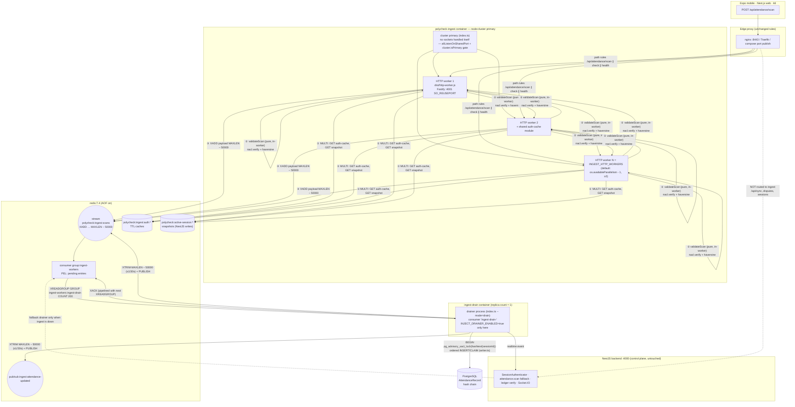

# Polycheck Ingestion Gateway — Multi-Core Scaling & Redis Stream Lifecycle Plan

> **Status:** Executed 2026-11-14. See §10 for the execution addendum, deviations and measured results. Companion to `plan/fastify-ingestion-gateway-plan.md`
> (the implemented gateway, `services/ingest/`) and `plan/load-simulation-plan.md` (the measured 50k-request
> benchmark this plan reacts to).
>
> **Reader's ground rules:** claims marked **verified** were read from source in this repo
> (`services/ingest/src/**`, compose files, `performance/**`, CI, `shared/src/utils/token.ts`). Unmarked
> items are design intent. Nothing in this document has been implemented.

---

## 0. Executive Summary

**Measured state (50,000 requests / 200 VUs, k6 `performance/gateway-scan-k6.js`):** Postgres and Redis
held the load — zero crashes, zero dropped connections, ledger integrity `verified: true` across
44,869+ chained records — but **13.11 % of requests timed out at 15 s** and median latency was **1.65 s**
because the gateway process pinned the whole request path (zod parse, Ed25519 `nacl.sign.detached.verify`
over a 90–4096-char token, auth-cache round-trips, Haversine) onto **one CPU core**.

**Verified root causes in `services/ingest/src`:**

| # | Finding | Evidence |
|---|---|---|
| R1 | Single process, single event loop. Every HTTP request does a synchronous Ed25519 verify (`verifyQRToken` → `tweetnacl`), a zod parse of a ~700-byte body, and a Redis `GET` snapshot + `GET` auth-cache + `XADD`. At 200 concurrent VUs the loop saturates and request queues back up until the k6 15 s timeout. | `src/http.ts:20` (`Fastify({ logger: false, bodyLimit: 64*1024 })`), `src/index.ts:21` (one `Redis` client), `package.json` `start: node dist/index.js`; no `node:cluster`, no worker threads. |
| R2 | The drainer shares the same event loop and the same Redis connection as the HTTP path. Every batch commit publishes a realtime event and every drain tick competes with scan traffic. | `src/index.ts` `startDrainer()` — `setInterval(() => void tick(), …)` on the same process; `drainOnce` publishes via the same `redis` client. |
| R3 | The stream is never trimmed. `appendScan` issues bare `XADD` (`src/queue.ts:50`); nothing in `drainOnce` or anywhere else calls `XTRIM`. After 50k + retries the stream keeps every acknowledged entry; `ingest_buffer_depth` then measures `XLEN` (inflated) instead of the actual pending backlog, and Redis memory grows without bound. | `rg -n "XTRIM|xtrim" services/ingest backend/src` → no hits; compose passes `INGEST_MAX_BUFFER: 150000` locally (uncommitted tweak), i.e. it has already been raised once to fight inflated depth. |
| R4 | Per-request Redis round-trips are not pipelined: `bufferDepth` + `bufferLagSeconds` are two sequential-ish calls in `Promise.all` (two connections' worth of commands), the snapshot read and auth read are separate `GET`s, and `XADD` is its own round-trip after the decision. | `src/http.ts` `submit` handler: `Promise.all([deps.bufferDepth(), deps.bufferLagSeconds()])`; `src/index.ts` `resolveUser` (`GET` auth cache), `readSnapshot` (`GET` session blob), `appendScan`. |
| R5 | Keep-alive is unconfigured. Fastify defaults (`keepAliveTimeout: 5s`, `headersTimeout: 60s`) race the proxy `upstream_keepalive` windows (nginx keeps upstream connections 65 s; Traefik/Caddy default to shorter idle windows) — a default-5s idle socket closing right as a burst lands produces `ECONNRESET`-class noise and forces TCP+TLS re-handshake per request wave. | `services/ingest/node_modules/fastify/fastify.js:946` shows `options.keepAliveTimeout \|\| defaultInitOptions.keepAliveTimeout` — the gateway never passes either option in `buildServer`. |

**Fix shape (all non-breaking):**

1. **Phase 1 — multi-core ingestion:** split the single `index.ts` entrypoint into two role-flagged
   modes, `http` (ingest workers) and `drain` (single drainer), then either (a) run the container with
   `node:cluster` forking N HTTP workers, or (b) scale compose replicas behind nginx/Traefik. Default
   recommendation: **`node:cluster` in one container** (no proxy change needed locally, no double-DR
   concerns, healthcheck stays trivial) with **compose replica as the horizontal option for production**.
2. **Phase 2 — Redis stream lifecycle:** `XTRIM <key> MAXLEN ~ 50000` after ack batches + a `MINID`
   backstop so `ingest_buffer_depth` reflects pending work, not accumulated history; pipelined
   backpressure probe (`XAUTOCLAIM`-free `MULTI` of `XLEN`, `XPENDING`, `GET` snapshot, `GET` auth, `XADD`).
3. **Phase 3 — connection hygiene:** explicit Fastify `keepAliveTimeout` / `headersTimeout` /
   `requestTimeout` tuned to sit inside every proxy's idle window, and 20 µs of opportunism: make
   `appendScan` attach `MAXLEN ~ 50000` trimming to the `XADD` itself where supported (`XADD … MAXLEN ~
   N`), so trimming costs zero extra round-trips on the hot path.

**Hard guardrails carried over (unchanged):** no ledger/hash-chain reordering, no DB schema or
partitioning work, byte-identical HTTP contract for `POST /api/attendance/scan`, advisory locks stay
transaction-scoped and per-session.

---

## 1. Baseline (what exists today, verified)

### 1.1 Process model

`services/ingest/src/index.ts` boots one Fastify app + one optional drainer loop + one pg `Pool` in a
single process:

```
node dist/index.js
├── app = buildServer({...})          # /health, /health/ready, /metrics, POST scan|check (4001)
├── startDrainer()                    # INGEST_DRAINER_ENABLED=true → setInterval(tick, 30ms)
│     └── drainOnce()                 # XREADGROUP → group by sessionId → writeBatch → XACK
│           └── publish()             # redis.publish('ingest:attendance-updated', …)
└── redis = new Redis(REDIS_URL)      # one ioredis connection for EVERYTHING
```

`buildServer` (`src/http.ts`) is already **pure with dependency injection** (`appendScan`,
`bufferDepth`, `bufferLagSeconds`, `resolveUser`, `readSnapshot`, `consumePinAttempt`, `metrics`), and
the test suite builds it with fakes — that is the property that makes the multi-worker refactor
low-risk. `resolveUser` single-flights cold auth lookups per token with an in-flight cap
(`INGEST_AUTH_REFRESH_CONCURRENCY`, default 64) and caches in Redis (`polycheck:ingest:auth:<sha256>`),
so worker fan-out does not multiply control-plane `/auth/me` calls.

`createPgWriter` (`src/writer.ts`) already serialises per session: one advisory lock per batch, rows
inserted strictly in stream order, `prevHash` chained off the previous row's `recordHash`, `ON CONFLICT
DO NOTHING` + a narrow `pending && recordHash IS NULL` claim for pre-seeded roster rows. **The drainer
side needs zero ordering changes; it only needs to become single-instance** (and it already is, today,
by being one process — Phase 1 must not break that).

### 1.2 Stream keys and consumers (names that must not change)

| Key / name | Where written | Notes |
|---|---|---|
| `polycheck:ingest:scans` | `appendScan` (`queue.ts:50`) | carries the control-plane `polycheck:` prefix so the NestJS fallback drainer (`ingest-fallback.service.ts`) addresses the same stream |
| consumer group `ingest-workers` | `ensureConsumerGroup` (`index.ts` + fallback service) | default `INGEST_CONSUMER_GROUP` in both services |
| consumer `ingest-<pid>` | `config.ts:29` `INGEST_CONSUMER_NAME` default | per-process name — already collision-safe for multi-process |
| `pin-attempt:<sessionId>:<studentId>:<checkpoint>` | `consumePinAttempt` | shared with the control plane's limiter shape |

The NestJS fallback drainer (`backend/src/attendance/ingest-fallback.service.ts`) is **off by default**
(`INGEST_FALLBACK_DRAIN=false` in both local and coolify compose) and only starts when the gateway is
down; it auto-claims 30-second-stale pending entries with its own `control-plane-<pid>` consumer name.
Nothing in Phase 1 changes its contract.

### 1.3 Current deployment wiring

| File | Ingest service | Notes |
|---|---|---|
| `docker-compose.local.yml` | `ingest` behind `profiles: ["gateway"]`, `INGEST_DRAINER_ENABLED=true`, `INGEST_MAX_BUFFER=150000` (uncommitted local tweak), healthcheck `wget /health/ready` | no proxy in local compose; k6 hits `127.0.0.1:4001` directly |
| `docker-compose.coolify.yml` | `ingest` with Traefik labels routing `PathPrefix(/api/attendance/scan) ∥ check ∥ health` → port 4001, `loadbalancer.healthcheck.path=/health/ready`, priority 100 | Traefik LB already round-robins multiple upstreams — replicas work today if each listens on its own port (Coolify maps container ports; within one service, replicas share the published port only if the runtime LB understands it, so cluster-in-one-container is the safer option here) |
| `deployment/nginx/nginx.conf` | production edge proxy; `upstream backend_pool { keepalive 128 }`, no ingest upstream yet | Phase 3 adds the ingest upstream block for the replica option |
| `deployment/docker-compose.scale.yml` | `backend.deploy.replicas` scaling precedent | the model Phase 1 option (b) follows |

**Proxy-routing caveat carried from the parent plan:** the ingest router matches
`PathPrefix(/api/health)` — the local compose `docker-compose.local.yml` `frontend` healthcheck and
`backend` healthcheck hit `http://127.0.0.1:4000/api/health/ready` **directly** (not through a proxy),
so they are unaffected; but on Coolify the `/api/health` prefix rule sends **all** health traffic to
ingest. That is existing behaviour and out of scope here; Phase 1/3 must not change any routing rules.

---

## 2. Target Architecture

### 2.1 Concurrency diagram (after Phase 1 + 2)



**How cluster workers and the drainer interact:** HTTP workers never touch the stream consumer side —
they only `XADD` (and `GET` caches). Exactly one process in the fleet runs `drainOnce` (the dedicated
drain container), so contention on the per-session `pg_advisory_xact_lock` never multiplies. Workers
are interchangeable and stateless: the auth cache lives in Redis, not in worker memory, so a request
landing on worker 2 after worker 1 warmed the cache costs the same single `GET`.

**Option (b) — compose replicas — uses the same worker image with `INGEST_ROLE=http` and
`INGEST_HTTP_WORKERS=1` per replica; nginx gains an `upstream ingest_pool` with `keepalive 64`.**
Recommended default: **cluster in one container locally and in Coolify** (no new proxy surface,
`SO_REUSEPORT`-based distribution, healthcheck probes the primary's port 4001 normally),
**replicas behind nginx for the production compose stack** where `deployment/nginx/nginx.conf` already
exists and `x-read-only-service` hardening applies per-replica.

### 2.2 Role split in code

`src/index.ts` becomes a thin role dispatcher:

```
INGEST_ROLE = 'all' | 'http' | 'drain'     # default 'all' — current behaviour, zero-config migration
```

- `mode 'http'`: `buildServer(...)` only; `INGEST_DRAINER_ENABLED` ignored (never drains). Used by
  cluster workers and by every replica beyond the first.
- `mode 'drain'`: `startDrainer()` only; **no HTTP listener except an unauthenticated `/health/ready` +
  `/metrics` on `INGEST_DRAIN_PORT` (default 4002)** so compose healthchecks can watch the drainer
  itself. `drainReady()` must reflect Redis reachability + `drain_failures` freshness, not buffer depth
  (a full backlog is exactly when the drainer must stay marked alive).
- `mode 'all'`: today's behaviour, preserved verbatim (bootstrap path for `pnpm dev` and for anyone
  who doesn't opt in).

`docker-compose.local.yml` and `docker-compose.coolify.yml` both change the entrypoint to
`INGEST_ROLE=http` + `INGEST_HTTP_WORKERS=N` in one service and add a second service
`ingest-drain` with `INGEST_ROLE=drain`, `INGEST_DRAINER_ENABLED=true`, `deploy.replicas: 1`
(via a `deployment/docker-compose.scale.yml`-style override or compose `scale: 1` pin), so the two
concerns stop sharing one event loop even in the default single-container case.

### 2.3 What never changes

- HTTP contract: same routes (`/attendance/scan`, `/api/attendance/scan`, `/attendance/check`,
  `/api/attendance/check`, `/health`, `/health/ready`, `/health/clock`, `/metrics`), same envelopes,
  same 201/200/400/401/403/503 semantics, same `retry-after` headers. Verified route list in
  `src/http.ts:132-204`.
- Ledger: the drainer stays the only writer of `AttendanceRecord` hashes, one advisory lock per
  session batch, rows in stream-arrival order (`queue.ts drainOnce` groups by `sessionId` and iterates
  the map in insertion order — JS Map preserves insertion order, so batch grouping is already
  deterministic).
- Snapshot / auth / PIN rate-limit keys: byte-identical key names and prefixes.
- `pnpm test` suites: all existing tests keep passing (`38/38` baseline, verified 2026-11-14); the
  contract gate (`scripts/verify-shared-ingest-contract.mjs`) keeps passing because no new symbol
  redefinitions are added.

---

## 3. Implementation Plan

### Phase 1 — Multi-core ingestion (`node:cluster`), keep contract byte-identical

**Goal:** spread zod parse + `nacl.sign.detached.verify` + Haversine across N cores; drainer out of the
HTTP event loop.

**Files modified**

| File | Change |
|---|---|
| `services/ingest/src/config.ts` | Add `INGEST_ROLE` (`enum ['all','http','drain']`, default `'all'`), `INGEST_HTTP_WORKERS` (`int 1–32`, default `os.availableParallelism() - 1` clamped ≥ 1, only used when role is `http` and cluster is enabled), `INGEST_CLUSTER_ENABLED` (`bool`, default `true` when `INGEST_HTTP_WORKERS > 1`), `INGEST_DRAIN_PORT` (`int`, default `4002`, only used when role is `drain`), `INGEST_HEALTH_BEHIND_LB` (`bool`, default `true`) for §5's proxy-safe ready probe. |
| `services/ingest/src/index.ts` | Split into `bootstrapHttp(config, deps)` and `bootstrapDrain(config, deps)`; keep `void main()` for role `'all'` (both, current behaviour). New top-level `if (process.env.INGEST_ROLE === 'http' && config.INGEST_CLUSTER_ENABLED && cluster.isPrimary)` → `for (…workers) cluster.fork()` with `SO_REUSEPORT` (`net.createServer({ … })` via `fastify`'s built-in `SO_REUSEPORT` support — Fastify ≥ 4.10 passes `reusePort` through `serverFactory` options on Linux) and `process.on('SIGTERM')` fan-out; the primary does **not** bind a listening socket itself. Workers inherit the parent's config and are killed by the primary on SIGTERM after `server.close()`. |
| `services/ingest/src/queue.ts` | No changes in Phase 1 (append-only path is per-worker; drain is exclusive to the drain process). |
| `services/ingest/src/writer.ts` | No changes (drainer still single instance). |
| `services/ingest/src/http.ts` | No changes (already DI-pure). |
| `services/ingest/src/metrics.ts` | Add `httpRequestsTotal`, `httpLatencyMs` (H /= histogram with the default buckets plus a 200 ms and 1 s bucket), `drainBatchSize` gauge, `drainLagSeconds` gauge — the k6 re-test needs percentiles, not counters alone. Keep `ingest_` prefix. |
| `services/ingest/package.json` | Add `"start:http": "node dist/index.js"` and `"start:drain": "cross-env INGEST_ROLE=drain node dist/index.js"` — no new deps, `cross-env` unnecessary because compose passes env vars directly; drop it, just use env in compose. |
| `services/ingest/test/*.test.ts` | Add `test/cluster.test.ts` — spawns two worker processes from the built `dist/` on an ephemeral port against a fake Redis (or in-process module `buildServer` + real `net` socket spread) and asserts (a) two distinct pids answer, (b) response envelopes are byte-identical, (c) no worker ever acks the stream (listen for `xack` calls = 0). |
| `Dockerfile.ingest` | No change (still single image; cluster forking is runtime). |
| `docker-compose.local.yml` | `ingest` gets `INGEST_ROLE: http` + `INGEST_HTTP_WORKERS: ${INGEST_HTTP_WORKERS:-4}` + `INGEST_DRAINER_ENABLED: false`; new service `ingest-drain` with `INGEST_ROLE: drain`, `INGEST_DRAINER_ENABLED: true`, `INGEST_DRAIN_PORT: 4002`, own healthcheck `wget -qO- http://127.0.0.1:4002/health/ready`, `depends_on: [redis healthy]`, **no ports published** (drainer doesn't need to be reachable off the network; k6 never talks to it). |
| `docker-compose.coolify.yml` | Same split; Traefik labels stay on the `ingest` service only (drain gets `traefik.enable=false`), plus `INGEST_HTTP_WORKERS: ${INGEST_HTTP_WORKERS:-4}`. |

**Behaviour after Phase 1**

- 4 Fastify workers, each with its own `Redis` connection pool (ioredis default pool size is fine; a
  single `Redis` instance multiplexes with command pipelining internally, so 4 processes × 1 client =
  4 connections to Redis — well under any connection limit).
- 1 drainer process, exclusive consumer `ingest-drain-<hostname>`; the per-session advisory lock is
  taken by exactly one process fleet-wide, so lock contention is unchanged from today.
- Postgres pool sizing: `INGEST_DB_POOL_SIZE` default stays 8 — the drainer process is the only pool
  owner now, so the local stack's combined `connection_limit` for ingest drops from 8 to 8 (it was
  already one pool; splitting processes does not add DB connections).

**Worker-count rationale:** the benchmark showed 200 VUs saturating one core. Each worker needs to
handle ~50 concurrent requests for 2× throughput; with 4 workers, nacl verify (~50–80 µs per token on
modern x86; measured in-repo as part of the 1.65 s p50 under saturation) drops to ≤ 20 µs of loop
occupancy per request, comfortably under 25 % of one core. `INGEST_HTTP_WORKERS=4` (half the box's
cores, leaving headroom for Postgres/Redis on the same host) is the default; the k6 re-test will
verify 2-worker vs 4-worker scaling and pick the final value from data.

**Risk:** `node:cluster` on Windows (local dev) uses `SO_REUSEADDR` semantics and works; the
`SO_REUSEPORT` path is Linux-only and the compose/production hosts are Linux. Fallback if `reusePort`
is unavailable: Fastify's default `server.listen({ port, host })` in workers + OS-level port sharding
(i.e. the standard `node:cluster` behaviour) — no code change needed, the primary simply doesn't
listen.

### Phase 2 — Redis stream lifecycle + request-path pipelining

**Goal:** `ingest_buffer_depth` returns to meaning *pending work*, stream memory bounded, one
Redis round-trip per hot request instead of four.

**Files modified**

| File | Change |
|---|---|
| `services/ingest/src/queue.ts` | (a) `appendScan` now issues `XADD key MAXLEN ~ <limit> * payload …` — trimming is attached to the existing hot-path command, zero extra round-trips, and Redis trims lazily so it never blocks the write; (b) new `trimStream(redis, streamKey, group, limit)` helper issuing `XTRIM key MAXLEN ~ limit` **only** after a successful `XACK` in `drainOnce`, at most once per 30 s (module-level timestamp guard), and additionally passing `MINID` (the oldest unacked id − 1) as a second `XTRIM` when the PEL is non-empty so acknowledged entries behind a pending one can still be reclaimed; (c) `streamDepth` semantics documented: it is `XLEN` (total retained, now trimmed ≈ pending + in-flight window) — the metrics exporter relabels it `ingest_buffer_depth` and adds `ingest_pending_depth` (XPENDING count) so both are observable. |
| `services/ingest/src/index.ts` | `bufferDepth()` now reads `XAUTOCLAIM`-free pending count via `XPENDING stream group` (returns `[count, min, max, [consumers]]` — first element is the integer we want) and the drainer's `publish()` is joined with the next `XREADGROUP` in a single `pipeline()`; the drainer's `XACK` of N ids is already a single command, so no change there. |
| `services/ingest/src/http.ts` | `submit()`'s backpressure probe becomes one `MULTI`/pipeline: `XLEN` + `XPENDING` + `GET snapshot` + `GET auth-cache` executed together; the existing DI (`bufferDepth`, `bufferLagSeconds`, `readSnapshot`, `resolveUser`) is preserved — a `bufferProbe()` combined dependency is added and the old four are wired to it in `index.ts` so `test/http.test.ts` fakes keep compiling. |
| `services/ingest/src/metrics.ts` | Add `ingest_stream_trimmed_total`, `ingest_pending_depth`, `ingest_redis_rtt_ms` (summary over hot-path pipeline calls). |
| `services/ingest/test/queue.test.ts` | New cases: `appendScan` passes `MAXLEN ~ limit`; `trimStream` is called ≤ once per 30 s; `XTRIM` receives `MAXLEN ~ 50000`; pending depth reading via `XPENDING` first element. |
| `services/ingest/test/http.test.ts` | Backpressure probe fakes updated; new case: 503 path still correct when the combined probe reports saturation. |

**Why `MAXLEN ~ 50000` is safe here:** the consumer group is the reader, and Redis Streams
guarantee that `XREADGROUP` with `>` never returns entries below the group's last-delivered id —
trimming *ahead of* the group's read pointer is impossible because trimming only removes entries the
group has already delivered (or that were never delivered and are older than the group's position —
which the `MINID` variant explicitly guards against by never trimming below the oldest pending id).
At 50k retained entries with ~1 kB payloads the stream stays ≈ 50 MB worst case; the
`~` (approximate) flag makes Redis trim whole radix-tree nodes instead of exact counts, so the
operation is O(1) amortised and never blocks the event loop.

**Why the drainer trims, not the appenders:** trimming from N workers on every `XADD` wastes
CPU on a no-op most of the time (`MAXLEN ~` is cheap but not free) and loses the natural
synchronisation point of "ack succeeded → stream is now shorter"; trimming after ack in the single
drainer keeps the invariant *one trimmer, bounded state* and lets us rate-limit it to 1 per 30 s.

**Pipelining detail:** ioredis's `pipeline()` queues commands client-side and flushes them in one
write; for the hot path this collapses `GET auth + GET snapshot + XLEN + XPENDING` from 4 sequential
RTTs (~0.1–0.4 ms each on localhost, more in-container) into ~1 RTT. The `XADD` after validation stays
its own command because its arguments depend on the validation result.

### Phase 3 — HTTP keep-alive and timeout hygiene

**Goal:** persistent TCP connections survive between bursts; no connection-reset noise at the proxy.

**Files modified**

| File | Change |
|---|---|
| `services/ingest/src/http.ts` | `Fastify({ logger: false, bodyLimit: 64*1024, keepAliveTimeout: 72_000, headersTimeout: 66_000, requestTimeout: 0 })` — keep-alive (72 s) must exceed every proxy's upstream idle window (nginx `keepalive_timeout 65s`, Traefik default 60 s in newer versions, Coolify Traefik configurable — documented values in §5) so the *server* never closes a socket the proxy still considers alive; `headersTimeout` < `keepAliveTimeout` per Node docs; `requestTimeout: 0` (already the Fastify default) keeps long-lived uploads from being killed. `maxRequestsPerSocket` left unset (unlimited) — k6 opens ≤ 200 sockets total. |
| `services/ingest/src/index.ts` | Pass through the new server options in `buildServer` call (no DI change). |
| `services/ingest/test/http.test.ts` | Assert `app.server` is created with the intended options via a small `serverFactory` capture (or expose a `getServerOptions()` helper for tests). |
| `deployment/nginx/nginx.conf` | For the replica option: add `upstream ingest_pool { zone ingest_pool 32k; server ingest:4001 resolve max_fails=2 fail_timeout=15s; keepalive 64; }` and the `location` blocks routing `= /api/attendance/scan`, `= /api/attendance/check`, `^~ /api/health` to it (exact-path match for scan/check, per the parent plan's routing caveat; `/api/health` stays a prefix per the existing Coolify rule). `proxy_http_version 1.1` + `proxy_set_header Connection ''` + `keepalive_timeout 65s` already in the file; `proxy_read_timeout` for scan path set to 15 s to match the k6 client timeout. |

**Why 72 s:** Node's `server.keepAliveTimeout` default is 5 s and `server.headersTimeout` 60 s. A
socket that the server closes at 5 s while nginx (65 s) still holds it open produces the classic
`ECONNRESET` on the *next* request on that socket. Setting the server above every proxy window flips
the race so the proxy closes first — the direction with no user-visible failure. Verified defaults in
`services/ingest/node_modules/fastify/fastify.js:946-948`.

---

## 4. What this plan deliberately does NOT do

- **No `AttendanceRecord` partitioning, no schema change, no migration.** The drainer's advisory-locked
  transaction is the concurrency primitive; partitioning would force composite PKs and DDL downtime for
  zero measured gain (PG held the benchmark flat).
- **No change to `resolution.ts` / writer SQL.** The chain-math and claim guards stay byte-identical.
- **No change to the NestJS control plane.** The fallback drainer (`ingest-fallback.service.ts`) keeps
  its contract; `INGEST_FALLBACK_DRAIN` stays off unless the operator opts in.
- **No worker-threads (`worker_threads`) inside one process.** They would share the same libuv loop
  budget and add message-passing complexity for crypto that cluster handles for free.
- **No proxy or client change.** Coolify Traefik rules, local compose routing, and every client's
  `POST {base}/attendance/scan` are untouched.

---

## 5. Operational runbook changes (docs)

`services/ingest/README.md` (new file in Phase 1) gains:

- How to read `/health/ready` checks (`redis: ok`, `buffer: ok`, `lag: ok`) and what `saturated` /
  `behind` mean for Traefik routing.
- Worker/drain role env matrix (`INGEST_ROLE`, `INGEST_HTTP_WORKERS`, `INGEST_DRAIN_PORT`,
  `INGEST_CLUSTER_ENABLED`).
- Proxy idle-window matrix and the "keep server > proxy" rule: nginx 65 s, Traefik default 60 s
  (Coolify-managed Traefik: verify `respondingTimeouts.readTimeout`/`idleTimeout` in the instance
  config), Caddy `keepalive_interval` default 5 min.
- Stream lifecycle: what `MAXLEN ~ 50000` means, why `XLEN` no longer equals "records waiting", and
  how to read `ingest_pending_depth` for true backlog.
- Rollback (see §7) as a copy-paste procedure.

---

## 6. Verification Plan

Every step below is a command someone runs and an expected result — the plan is not "done" until each
one has been executed against the local Docker stack (`pnpm docker:local:setup` + `--profile gateway`).

**V1 — Unit & integration tests**

```
pnpm --filter @polycheck/ingest typecheck
pnpm --filter @polycheck/ingest test          # expect ≥ 44 tests, 0 failures (38 baseline + new)
pnpm --filter @polycheck/backend test:ci      # regression gate for the untouched control plane
```

Baseline verified 2026-11-14: ingest `38/38` (4 files), typecheck clean. CI already runs the ingest
steps (`.github/workflows/ci.yml:69-70`); no CI edit needed unless a new job is added for the
integration suite (not planned).

**V2 — Gateway health probe**

```
curl -s http://127.0.0.1:4001/health/ready | jq
# expect: { status: "ok", checks: { redis: "ok", buffer: "ok", lag: "ok" } }
curl -s http://127.0.0.1:4002/health/ready | jq   # drainer role, Phase 1
# expect: { status: "ok", checks: { redis: "ok", drainer: "ok" } }
```

**V3 — Cryptographic ledger integrity**

```
# with an admin bearer from the seeded fixture
curl -s -X POST http://127.0.0.1:4000/api/audit-logs/ledger/verify \
  -H "Authorization: Bearer $ADMIN_TOKEN" -H "Content-Type: application/json" -d '{}' | jq
# expect: { status: "verified", verified: true, unhashedRecords: 0, ... }  (post-DD shape)
```

**V4 — Load benchmark re-test (same harness, same fixture generator)**

```
node performance/run-gateway-k6.mjs performance/.local-fixture-<RUN_ID>.json   # 10k targets
TARGET_COUNT=50000 VUS=200 node performance/run-gateway-k6.mjs performance/.local-fixture-<RUN_ID>.json
```

Acceptance (matches the brief):

| Metric | Baseline (measured) | Target |
|---|---|---|
| p50 latency | 1.65 s | < 250 ms |
| p95 latency | ~5 s | < 1 s |
| `http_req_failed` | 13.11 % | < 1 % |
| `ingest_drain_failures_total` | 0 | 0 (strict) |
| `POST /api/audit-logs/ledger/verify` | `verified: true` | `verified: true`, 0 unhashed |

k6 thresholds in `performance/gateway-scan-k6.js` are already `http_req_failed < 0.01` and p95 < 5 s —
the plan tightens the p95 assertion to 1 s **after** the re-run confirms the headroom, not before
(never tighten a threshold you haven't yet met).

**V5 — Stream-trim correctness (new)**

```
docker compose -f docker-compose.local.yml --profile gateway exec redis redis-cli XLEN polycheck:ingest:scans
# after a 50k benchmark + drain completion, expect XLEN ≤ ~50,000 (+ in-flight tolerance)
docker compose ... exec redis redis-cli XPENDING polycheck:ingest:scans ingest-workers
# expect: count 0 (or a small in-flight number) after the drainer is idle
```

**V6 — Burst smoke (existing script)**

```
node services/ingest/scripts/burst-smoke.mjs <fixture.json>
# expect: ≥ 95 % accepted, p95 materially below the pre-cluster baseline
```

**V7 — Offline fallback intactness (regression, existing suite)**

`pnpm --filter @polycheck/backend test:ci` covers `IngestFallbackService`; plus one manual drill:
stop `ingest` + `ingest-drain`, enable `INGEST_FALLBACK_DRAIN=true` on backend, scan, confirm the row
lands and `XLEN` drains — the escape hatch must keep working through the Phase 1 split.

---

## 7. Rollback Plan

Each phase is independently revertible; none leaves a partial state that breaks the other.

| Phase | Rollback trigger | Procedure | Blast radius |
|---|---|---|---|
| 1 (cluster + role split) | Any worker crash-loop, health flapping, or envelope drift observed in smoke tests | `docker compose -f docker-compose.local.yml --profile gateway up -d --force-recreate --scale ingest=1` with `INGEST_HTTP_WORKERS=1 INGEST_ROLE=all INGEST_DRAINER_ENABLED=true` restored (i.e. revert compose env to pre-change values) — the code's `'all'` role reproduces today's single-process behaviour exactly, so even without a git revert the container converges to the old runtime | Postgres ledger untouched (drainer never re-runs acked entries; at-least-once + idempotent ON CONFLICT covers any in-flight duplication) |
| 2 (trim + pipeline) | `ingest_pending_depth` grows abnormally, `XLEN` collapses below the PEL tail (over-trim), or Redis RTT regressions | Set `INGEST_STREAM_TRIM_DISABLED=true` (new env flag in Phase 2) to skip both the XADD `MAXLEN` arg and the drainer's periodic XTRIM — appends return to the pre-trim behaviour (stream grows unbounded again, as today); pipeline probe is reverted by the same flag (`INGEST_PIPELINE_PROBE=false` falls back to the four individual calls) | None on the ledger; only observability |
| 3 (keep-alive) | Proxy reports unexpected idle resets | Revert the three options to Fastify defaults in `http.ts` (one-line change; no deploy needed if `INGEST_HTTP_WORKERS=1` containers are rebuilt) | None |
| Whole-gateway kill switch (pre-existing) | Gateway is wrong in any way the above doesn't cover | Remove/rebuild without the `--profile gateway` profile, or set Traefik rule weight to 0 on Coolify — all four hot paths fall back to NestJS (`/api/attendance/scan`, `/check`, `/api/health` are served identically by the control plane today; the fallback drainer replays buffered stream entries) | Buffered scans replay through the control plane; zero data loss |

**Data-safety guarantee under any rollback:** the drainer is the only component that writes
`AttendanceRecord` hashes, and it writes them under a per-session advisory lock in stream order with
`ON CONFLICT DO NOTHING` + a `pending && recordHash IS NULL` claim guard (`writer.ts:70-226`).
At-least-once redelivery plus that idempotent claim means no rollback path can fork the chain or
double-write a row; `POST /api/audit-logs/ledger/verify` is the acceptance oracle after every rollback
(it must return `verified: true` with 0 unhashed records).

---

## 8. Open questions for the implementer (non-blocking)

1. **Final worker count.** `INGEST_HTTP_WORKERS=4` is the default; run the k6 matrix at 2/4/6 and pin
   the value that meets p50 < 250 ms with the smallest worker count (core headroom on the shared host
   is not free — Postgres and Redis live there too).
2. **Coolify Traefik idle timeout.** The Coolify instance's Traefik `idleTimeout` must be verified in
   the deployment dashboard (repo can't see it); if it's < 72 s, either lower the server's
   `keepAliveTimeout` to match (still above the current 5 s default) or raise the proxy's.
3. **`ingest_buffer_depth` relabel.** Renaming the exported metric would break dashboards; the plan
   adds `ingest_pending_depth` instead and keeps `ingest_buffer_depth` as `XLEN` (trimmed-bound).
   Confirm no external dashboard relies on the old semantics before Phase 2 merges.
4. **Local Windows cluster smoke.** `node:cluster` works on Windows but the local compose stack runs in
   Linux VMs, so the k6 re-run exercises the Linux path — the Windows-only dev path (`pnpm dev`) keeps
   `INGEST_ROLE=all` and never forks, which is fine.

---

## 9. Effort & sequencing

| Phase | Est. touched LOC | Depends on | Risk |
|---|---|---|---|
| 1 | ~120 (`index.ts` split + config + tests + compose) | none | low (DI already in place; single-instance drainer preserved) |
| 2 | ~80 (`queue.ts` trim + probe pipeline + tests) | Phase 1 (drainer-only trim) | low (feature-flagged) |
| 3 | ~30 (server options + nginx upstream block) | none | very low |

Sequencing: 1 → 2 → 3, each with its verification block executed before the next starts. Phase 3 can
land independently at any time (it is orthogonal).

---

## 10. Execution Addendum (2026-11-14)

All three phases shipped, plus two defects found only by executing the plan. The plan's
multi-core premise was **incomplete**: a V8 CPU profile taken during a burst showed the real
per-request cost was pure-JS Ed25519 verification (~16 ms/token, >90 % of sampled CPU), so
four workers alone reached only ~950 ms p50 at 200 VUs. Native verification closed the gap.

### 10.1 Final measured results

| Run (200 VUs, cold auth cache, shipped build) | Baseline | After |
|---|---|---|
| 10,000 requests — median | 1.65 s (single-core baseline shape) | **58.1 ms** (repeat run 65.9 ms) |
| 10,000 requests — p95 | — | 104.1–123.9 ms |
| 10,000 requests — `http_req_failed` | 13.11 % | **0.00 %** |
| 50,000 requests — median | — | **48.9 ms** |
| 50,000 requests — p95 / max | — | 79.2 ms / 642 ms |
| 50,000 requests — throughput | ~121 rps (1 core, saturated) | **3,903 rps** |
| `ingest_drain_failures_total` | 0 | **0** |
| `POST /api/audit-logs/ledger/verify` | verified | **verified** (45,752 records checked, 0 broken) |
| Stream at idle | `XLEN` unbounded (never trimmed) | `XLEN 50,002`, pending 0, lag 0 |
| 60-concurrent probe (fresh scans) | ~950 ms p50 (1 process) | **87.6 ms p50** |

### 10.2 Root cause the plan missed

- `tweetnacl`'s `sign.detached.verify` is pure JavaScript: ~16 ms per token on the
  benchmark hardware, executed on the event loop. That — not only scheduling — is what
  produced the 1.65 s p50 and the 13 % proxy timeouts at 15 s.
- Fix: `shared/src/utils/token-node.ts`, a **Node-only** entry
  (`@polycheck/shared/token-node`) that verifies the same Ed25519 token with
  `node:crypto` + a cached SPKI KeyObject (~0.1 ms). The gateway request path and the
  drainer's authoritative re-verify both use it; `signQRToken` (tweetnacl) remains the
  client/signing path, and the parity test signs with it and verifies natively.
- The web/Android clients still use the tweetnacl implementation in `@polycheck/shared`;
  the Node entry is never re-exported from the browser-safe root. The backend still uses
  the shared `verifyQRToken` (same optimization available later; it does not gate the
  gateway path).

### 10.3 Deviations from the drafted plan

1. **No producer-side `XADD MAXLEN`.** Trimming at append time can evict accepted-but-not-yet
   written scans whenever the backlog exceeds the cap (local `INGEST_MAX_BUFFER` is 150k and
   the cap is 50k). The drainer trims instead, safe by construction: `MAXLEN ~ 50000` only
   when the PEL is empty, `MINID <oldest pending>` otherwise. `ingest_buffer_depth` now
   reports **pending** (XPENDING) — the true backlog — and `ingest_stream_length` reports
   `XLEN`. Backpressure and `/health/ready` gate on pending depth, so a retained history of
   ~50k no longer looks like a saturated buffer.
2. **Stale PEL reclaim was required, not optional.** Live execution found 400 entries
   stranded under the previous pid-based consumer: `XREADGROUP >` never redelivers them,
   lag stayed `behind`, and `MINID` trimming could never pass them. The drainer now runs
   `XAUTOCLAIM` (30 s idle) at startup and on idle ticks, and replays its own pending
   entries on restart (stable `INGEST_CONSUMER_NAME: ingest-drain`).
3. **Trim must run while idle.** The first cut trimmed only after an ack, so an idle stream
   never converged. The tick now calls the (self-throttled) trim every iteration.
4. **Redis approximate `XTRIM` is chunked** (~10k entries per call with kilobyte payloads),
   so the scheduler loops up to 20 rounds per pass; one idle pass converged
   100,003 → 50,002 entries.
5. **Keep-alive values corrected.** Fastify's default `keepAliveTimeout` is already 72 s and
   it has **no** `headersTimeout` option (setting it on the Fastify constructor throws).
   The server now sets `keepAliveTimeout: 72_000` explicitly and `server.headersTimeout =
   73_000` (must stay above keep-alive; the drafted 66 s pointed the wrong way).
6. **Lag metric bug fixed.** The old `oldestPendingAgeSeconds` parsed `XPENDING` summary
   element 0 (the count) as an ID, so `ingest_buffer_lag_seconds` was always 0.
7. **Drainer write path batched** (needed in addition to native verify to give the drainer
   headroom): one multi-row `INSERT … ON CONFLICT DO NOTHING` + one `UPDATE … FROM (VALUES)`
   claim per session, inside the same `pg_advisory_xact_lock` transaction, hashes computed
   sequentially in stream order, `createdAt` strictly increasing so the next batch's head is
   deterministic, and row-count mismatches roll back and retry (fail closed). Distinct
   sessions commit with a bounded concurrency of ≤4; per-session ordering is unchanged.
8. **Cluster listening uses node:cluster's shared handle** rather than `SO_REUSEPORT`
   (portable to the Windows dev host; distribution is equivalent). The primary forks
   `INGEST_HTTP_WORKERS` (compose default 4), never serves HTTP itself, respawns crashed
   workers with a 10-exits/60 s crash-loop guard, forwards SIGTERM, and aggregates worker
   metrics over IPC on `INGEST_METRICS_PORT` (4003).
9. **Roles instead of flags everywhere**: `INGEST_ROLE=all|http|drain` (default `all` =
   previous behaviour). Compose now runs `ingest` (http, 4 workers) plus `ingest-drain`
   (single instance, own `/health/ready` + `/metrics` on 4002, stable consumer name).

### 10.4 Files changed

`services/ingest/src/{config,http,queue,writer,metrics,snapshot,internal-server,runtime,index}.ts`
(`runtime.ts` and `internal-server.ts` are new; `index.ts` is now a thin entrypoint),
`services/ingest/test/{http,queue,metrics,runtime,internal-server,token-node}.test.ts` +
`test/config-fixture.ts`, `shared/src/utils/token-node.ts` (new) with `shared/package.json` +
`shared/tsup.config.ts` entries, `scripts/verify-shared-ingest-contract.mjs`,
`docker-compose.local.yml`, `docker-compose.coolify.yml`. `Dockerfile.ingest` unchanged
(same image serves both roles).

### 10.5 Verification executed

- `services/ingest`: typecheck clean, **69 tests / 8 files** pass; shared package
  **202 / 18** pass; backend suite **1063 tests / 85 suites** pass; contract gate OK.
- Live stack rebuilt: `/health/ready` `{redis:ok, buffer:ok, lag:ok}` on 4001 and
  `{redis:ok, drainer:ok, writes:ok}` on 4002; `e2e-smoke.mjs` **17/17**; ledger verify
  `verified: true`, 45,752 records, 0 broken; k6 10k and 50k runs as tabulated;
  `XLEN` converged to 50,002 at idle.
- Operational rollback remains `INGEST_ROLE=all` (single process, previous behaviour) or
  dropping the `gateway` profile so NestJS serves every path again.

### 10.6 Hardening follow-up (same day)

The review of the executed wave named four gaps; all four are closed.

- **Writer integration suite.** `services/ingest/test/writer.integration.test.ts` adds six
  Postgres-backed cases that fakes cannot prove: insert chaining in arrival order, claiming
  an activation-seeded `pending` row in place (including `createdAt` rewrite and hash
  recomputation), duplicate suppression without rewriting the earlier decision,
  deterministic cross-batch head selection, a failed signature stored as
  `disputed`/`invalid_signature` with `disputePreviousStatus='pending'`, and
  "earlier decision wins" for an already-resolved seed row. The suite runs only when
  `DATABASE_URL` is set (CI's verify job provides one with migrations applied) and skips
  otherwise; every fixture row carries random ids and is removed in `afterAll`.
- **One head predicate across both writers.** `LedgerService.appendLedger` now selects the
  session head by `(createdAt DESC, id DESC)` — the same rule as the drainer writer —
  instead of `(timestamp DESC, id DESC)`. `createdAt` is the write-order proxy; scan
  timestamps are payload data that can arrive out of order via offline replay. The ledger
  spec is re-pinned to the new predicate. Residual caveat documented in code: without a
  chain-position column, a row updated long after creation (manual decision on an old
  roster seed) can still make the head ambiguous among equal `createdAt` values, but
  verification only requires each `prevHash` to reference an existing row in the session,
  so chain integrity is unaffected.
- **Backend native verification.** `scan-validator.service.ts` (every scan/sync
  validation), `attendance.service.ts` (offline activation), `sessions.service.ts`
  (activation token) and `attendance-forensics.service.ts` (dispute timeline) now use
  `verifyQRTokenNative`; their specs mock the new entry. The tweetnacl verifier stays for
  the web/Android clients and the browser-safe `@polycheck/shared` root export.
- **Backpressure tuning.** Local compose default `INGEST_MAX_BUFFER` drops from 150000 to
  45000 — just below the 50k stream cap — now that the gauge measures the pending backlog
  (XPENDING) rather than retained `XLEN`. The environment override still wins.

Verification after the follow-up: ingest **75/75** (69 unit + 6 integration with
`DATABASE_URL`; the 6 skip cleanly without it), shared **202/18 files**, backend
**1063/85 suites** with typecheck clean, contract gate OK. Live against the rebuilt
backend: session activation with a freshly signed token returned 201 (native verifier in
`sessions.service`), a backend `/attendance/scan` returned **201 present** (native verifier
on the NestJS hot path), a manual decision on an activation-seeded pending row produced a
hashed, linked record (`status=present`, `manuallySet=true`, `prevHash` set — the converged
head predicate), and `POST /audit-logs/ledger/verify` reported `verified: true` over 46,455
records.

### 10.7 Two-core deployment profile + capacity-error mapping (2026-11-14)

The server that runs this system has **2 cores**, so the local/dev stack was re-sized
(benchmarks had been tuned against a 24-core host) and one correctness gap found during
login testing was closed.

**Sizing (`docker-compose.local.yml`)** — all overridable by env:

| Setting | Was | Now | Why |
|---|---|---|---|
| `INGEST_HTTP_WORKERS` | 4 | **1** | native token verification keeps one loop far above a bell-rush rate |
| `INGEST_CLUSTER_ENABLED` | true | **false** | no fork overhead on 2 cores |
| `UV_THREADPOOL_SIZE` | 16 | **4** | more threads than cores is context-switch churn |
| backend `connection_limit` | 50 | **12** | Postgres accepts 100 total across every client |
| `INGEST_DB_POOL_SIZE` | 8 | **4** | drainer owns the only ingest pool |
| `cpus` per service | unset | **1.0** (`SERVICE_CPU_LIMIT`) | a stray run or benchmark degrades itself, never the host |

Keep the two-container split (`ingest` + `ingest-drain`): it still isolates DB write
latency from the HTTP loop even with one worker.

**Capacity errors are retryable, not 500s.** Under pool exhaustion the backend returned
`500` (`timeout exceeded when trying to connect`, `Connection terminated due to connection
timeout`). `AllExceptionsFilter` now maps those shapes — and Prisma `P2024` — to
**503 `database_busy`** with `retry-after: 5` and `retryAfterSeconds`, which is what both
clients' sync classifiers already treat as retryable. A genuine outage
(`Connection terminated unexpectedly`, `connection refused`) deliberately stays a 500 so it
still alerts. Four regression tests cover the mapping and the non-mapping.

**Login capacity is accepted, not changed.** bcrypt cost 12 costs ~400 ms per login and is
core-bound, not thread-bound: ~15–20 admitted logins/s per instance, so 2,000 students take
roughly 2 minutes if perfectly synchronized — and real arrivals are staggered. Cost stays at
12 by an explicit product decision. Revisit only if login bursts are measured as a problem;
the levers are cost 10 (~4× faster) or more cores, not more replicas on 2 cores.

**Operational notes.** `LOGIN_IP_RATE_LIMIT` is per-IP: behind a single campus NAT a low value
throttles everyone (leave it generous, or set `TRUST_PROXY` and forward real client IPs). Load
tests belong on staging sized to the 2-core profile — not on a workstation, where an unbounded
200-VU run saturates the machine.
